# Subgrid terrain (#508): what we are building and where it stands

State on 2026-11-12. Branch `develop_subgrid` at the commits listed at the end.
Read `SUBGRID_START_HERE.md` for setup and rules, and `SUBGRID_DESIGN.md` for the plan.
The figures are in `claude/figures/subgrid/`. Regenerate them from the bench results with
`python subgrid_bench/report_figures.py`.

## Summary

- **Phases 0, 1 and most of 2 are done** as a prototype in mode 1 (legacy, CPU). The
  storage tables, effective bed, conveyance friction, subface edge fluxes, a
  draining-time limiter and a conveyance-weighted subface velocity all run end to end
  on the synthetic benchmark.
- **The best variants are the EKLC runs.** Against the 569 000-triangle reference
  (band025TU, 100 min on the GPU):
  - `coarse500_sub8EKLC` (3082 triangles, 99 s on 8 CPU threads): flood extent CSI
    0.96, outlet peak 52.3 m³/s against 52.1, mean |peak-stage error| 2.7 cm;
  - `coarse2000_sub8EKLC` (780 triangles, 14 s): CSI 0.91 (0.93 with the switch on),
    outlet peak 52.5–52.8, mean |peak-stage error| 2.7–3.7 cm;
  - peak timing within 2 minutes of the reference for both.
- **Reference correction:** the reference runs were biased. ANUGA's flux diffused
  momentum across the channel–bank shear, making resolved channels too resistive.
  That is now fixed upstream as an opt-in switch (#509, PR #510, merged), and the
  references have been rerun with it.
- **Outlet reach explained:** the low levels approaching the steep outlet reach come
  from the coarse cells at the critical-depth control. Refining only those cells
  removes the error, including upstream of the refined area (see *The outlet reach*).
- **The conveyance closure is the weak spot.** On a flat-plain bench with relief the
  subgrid front spreads 120–140 m too far in 2 h, because Kc adds the sub-triangles
  side by side. Experimental fixes (strips, hollows, connectivity, two-compartment
  storage) are in the bench, off by default (see *Next: better closures*).
- **Still to do:** the production steps of Phase 3. The tables live in a Python
  operator in the bench, not in a flow algorithm. There is no GPU (mode 2) path, the
  operators (inlets, rain, culverts) haven't been audited, and there is no parallel
  support.

| Phase | State |
|---|---|
| 0 · benchmark: synthetic valley, flood hydrograph, fine references, scoring | done |
| 1 · storage: volume–level tables per cell, effective bed, lake at rest and mass tests | done |
| 2 · conveyance: conveyance friction, subface edge fluxes, draining limiter, conveyance split | mostly done (still a Python operator) |
| 3 · production: DE_subgrid flow algorithm, GPU, operator audit, parallel, output, DEM builder | not started |

## The problem

Floodplain models are often run on triangles of hundreds to thousands of square metres,
because that is what fits the time budget. A river channel is much narrower. In the test
valley the channel is 18 m wide at the top and 2 m deep, so a 2000 m² triangle can't
resolve it.

A coarse cell has to pick one bed level:
- If it takes the terrain at its centroid, most cells see floodplain and the channel
  vanishes.
- If it carves a trench into every cell the channel crosses, the channel becomes far too
  wide and too smooth.

Either way, both the storage and the conveyance are wrong. The subgrid method keeps the
coarse mesh for the flow equations, but gives every cell and every edge lookup tables
built from the fine terrain. A cell knows how much water it holds at any level and how
easily that water flows; an edge knows the bed along its length.

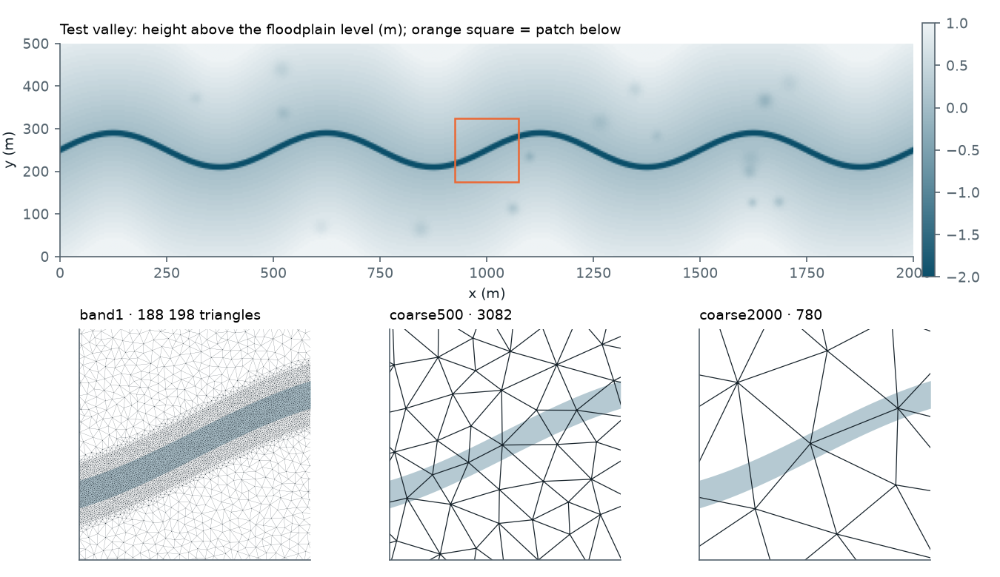

*Top: the 2000 × 500 m valley at a 1:1000 slope, coloured by height relative to the
floodplain level. The dark meander is the trapezoidal channel (10 m base, 1:2 banks, 2 m
deep); the spots are floodplain hollows, and the floodplain rises 1 m over 250 m away
from the channel. The terrain is an analytic function sampled on a 0.5 m grid (4 million
pixels). A flood hydrograph of 5 → 60 → 5 m³/s enters at the left over 4 hours. Bottom:
the orange patch on the band1 reference mesh (1 m² triangles along the channel, 25 m² on
the floodplain) and on the coarse500 and coarse2000 meshes, with the channel shaded. A
single coarse triangle holds a stretch of channel plus its banks.*

## Inside a coarse cell: storage and conveyance tables

Each coarse triangle is split into 8 × 8 = 64 equal sub-triangles, each holding the mean
of the 0.5 m terrain pixels inside it. That is the only terrain information the model
keeps. From the 64 bed levels z_k, sorted, it builds three functions of the water level η:

```
mean depth      h(η)  = (1/m) Σ max(η − z_k, 0)
wet fraction    f(η)  = (number of z_k < η) / m
conveyance      Kc(η) = (1/m) Σ max(η − z_k, 0)^(5/3) / n_k
```

h is the cell's water volume per unit area, f the share of the cell that is wet, and Kc
the conveyance per unit width (the discharge a unit friction slope drives). With the
sub-beds sorted, h(η) is piecewise linear, and its inverse η(h) is a search plus one
division.

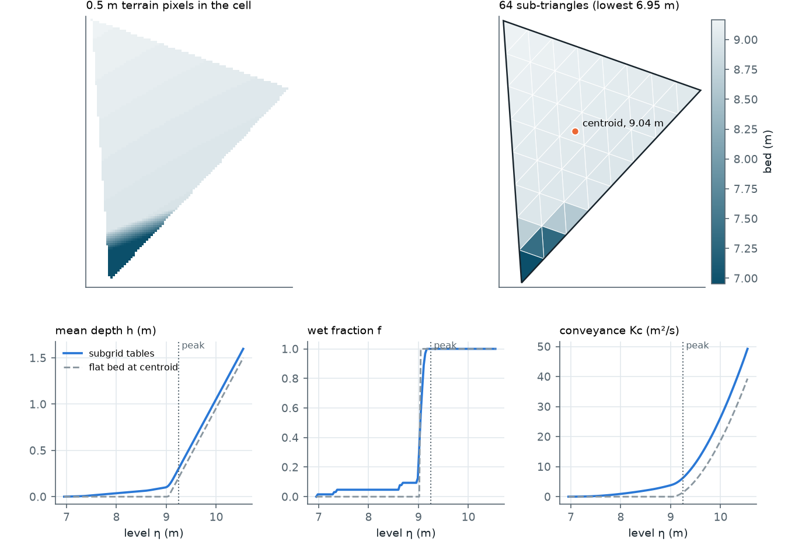

*A real 1278 m² triangle from the coarse2000 mesh. Its centroid lands on the floodplain
at 9.04 m, but the channel crosses one corner and the lowest sub-triangle is at 6.95 m,
2.1 m lower. A centroid-bed model would see no channel here at all. At the flood peak in
the EKLC 2000 run this cell reaches η = 9.25 m: the tables give a mean depth of 0.31 m
with the whole cell wet, where a flat bed at the centroid would hold 0.21 m. The
conveyance is 6.4 m²/s against 1.5 m²/s, because the water is concentrated in the deep,
smoother channel.*

How the tables enter the coarse scheme:
- **Storage.** ANUGA keeps conserving the mean depth h = stage − bed, so volume is exact.
  After every step the subgrid operator sets the level to η(h), then moves the cell's
  bed to d = η − h and its stage to η. A dry cell's bed is its lowest sub-triangle, so a
  channel crossing the cell sets where water first collects.
- **Conveyance friction ("K").** ANUGA's Manning friction is −g n² |q| q / h^(7/3).
  Setting the cell's n to n_eff = h^(5/3)/Kc(η) turns it into exactly −g h |q| q / Kc²,
  the friction of the cell's real cross-section. A cell whose water is mostly in a deep
  channel gets a small n_eff and flows faster.

## Across an edge: subfaces and the conveyance split

Storage and friction alone aren't enough. A coarse edge that crosses the channel must pass
water through its channel part even when the rest of the edge is dry.

- **Edge subfaces ("E").** Every edge is split into 16 subfaces, each with its own bed
  sampled along the edge. The flux kernel computes the central-upwind flux and
  hydrostatic pressure on each subface with its own depth h_j = η − z_j, and sums them.
  Subfaces are clipped below at the lowest point of the higher neighbouring cell, so a
  flux can never draw water from below a cell's lowest point.
- **Conveyance split ("C").** Without it, every subface gets the cell's mean velocity, so
  discharge goes with depth: shallow floodplain subfaces carry too much and the deep
  channel subfaces too little. Over the whole valley about a third of the flow went over
  the floodplain, which flattened the flood peak (46.7 against 52.1 m³/s). With the
  split, each subface gets the velocity its own depth and roughness support under the
  same friction slope, u_j = u · (n_eff/n_j) · (h_j/h)^(2/3). A uniform cell gets weight 1
  everywhere, so nothing changes there. It needs a cap CFL of 0.5: at 0.75, partly wet
  channel cells near the inlet oscillate.

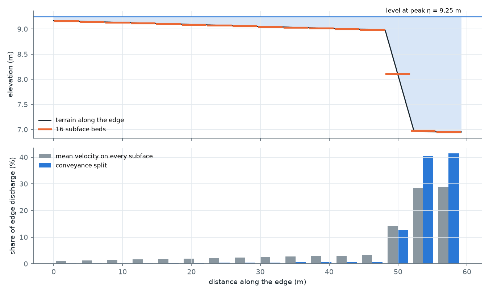

*Top: the bed along a 59 m edge of the example cell, the 16 subface beds the kernel uses,
and the water level at the flood peak. Bottom: how the edge's discharge is shared
between subfaces, with both distributions scaled to the same total. With the cell's mean
velocity on every subface, the channel subfaces carry 72% of it. With the conveyance
split they carry 95%, because deep water in the smoother channel (n = 0.035 against
0.05) flows faster.*

## One time step

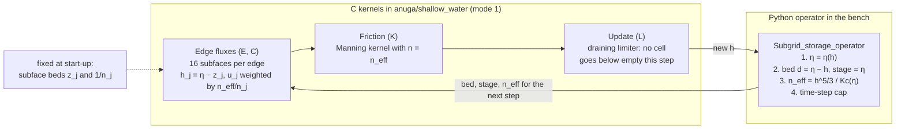

The C pieces are switched on only when the domain carries subgrid arrays. The table update
is a Python operator that runs after the inlet each step. Letters match the run names:
E = edge subfaces, K = conveyance friction, L = draining limiter, C = conveyance split.
Storage tables are always on in a subgrid run.

**Time step and limiter ("L").** A partly wet cell has a free surface of only f·A, so a
given volume change moves its level by 1/f times what the coarse scheme expects. The first
fix was a time-step cap scaled by f, which needed over a million steps. The draining-time
limiter keeps every depth non-negative for any step, so the cap can drop the f factor
(`EDGE_CAP_P = 0`), and the step count fell 30-fold.

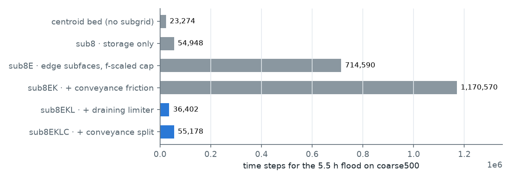

## Results

The reference is `band025TU`: *band* is a refined band along the channel, *025* means
0.25 m² triangles in it (25 m² on the floodplain, 569 004 triangles), and *TU* means the
corrected flux (LF1 + tangential upwind, see below), run on the GPU (5998 s). The
references have converged: band1LF4 (1 m², same flux) is within 1.8 cm mean peak stage and
0.3 m³/s outlet peak, and band025 (old flux) within 2.0 cm.

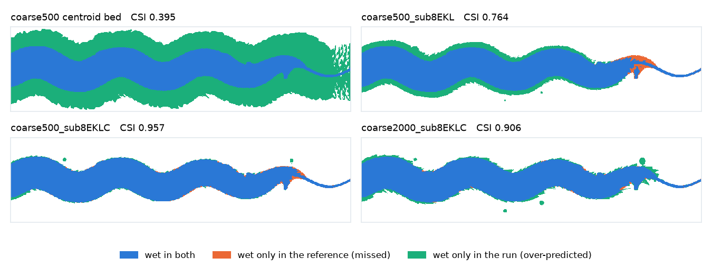

*Coarse cells' peak levels compared with the terrain on a 2.5 m grid: a point is wet if
its cell was wet and the cell's peak level is above the ground there. The centroid-bed
model floods the floodplain far too widely, because its channel is missing. EKL keeps the
channel but still pushes too much flow onto the floodplain. EKLC matches nearly
everywhere. CSI = both wet / either wet.*

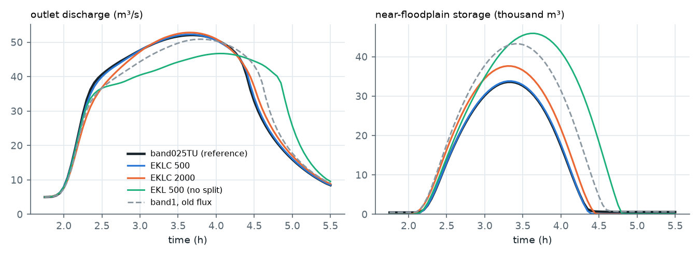

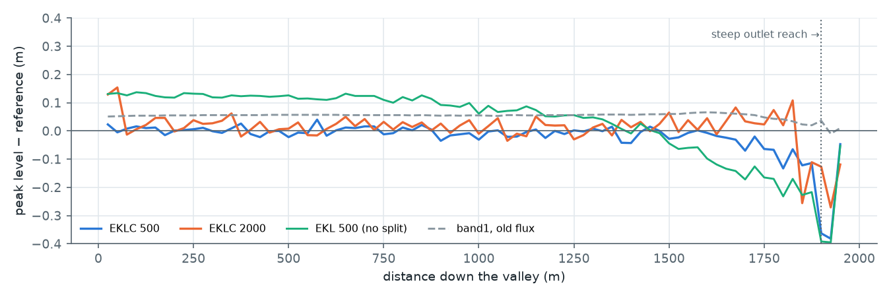

*EKLC stays within a few centimetres along most of the valley. All the coarse runs run
low below x ≈ 1600 m, approaching the steep outlet reach that starts at x = 1900 m, where
a coarse cell straddles the change of slope. EKLC 500 is 0.38 m low at x = 1925 m. The
section on the outlet reach below traces this to the cells at the control. The
centroid-bed model, not drawn, is 0.46 m high on average and up to 0.96 m.*

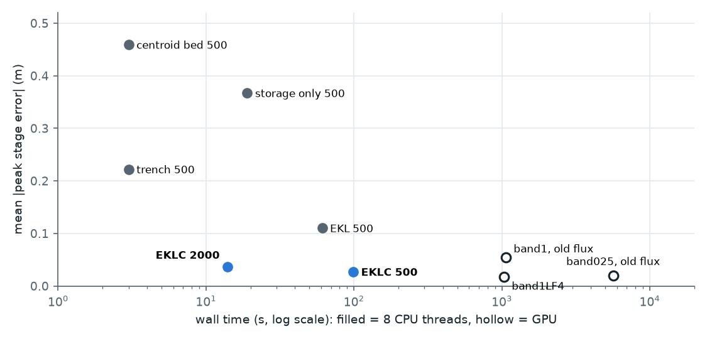

*Wall time on a log scale; filled points ran on 8 CPU threads, hollow points on the GPU
(RTX 5070). The GPU references would take several times longer on the CPU.*

| run | triangles | wall | CSI | outlet peak Q | peak time | mean peak stage error (mean abs) |
|---|---|---|---|---|---|---|
| **reference band025TU** | 569 004 | 5998 s GPU | 1 | 52.1 | 3.69 h | 0 |
| band1LF4 | 188 198 | 1032 s GPU | 0.944 | 51.8 | 3.73 h | +0.018 m |
| band025 (old flux) | 569 004 | 5653 s GPU | 0.938 | 51.5 | 3.74 h | +0.020 m |
| band1 (old flux) | 188 198 | 1063 s GPU | 0.845 | 50.9 | 3.79 h | +0.053 m |
| coarse500 centroid bed | 3082 | 3 s | 0.395 | 52.4 | 3.94 h | +0.459 m |
| coarse500 trench | 3082 | 3 s | 0.644 | 46.0 | 4.12 h | +0.093 (0.222) m |
| coarse500_sub8 (storage only) | 3082 | 19 s | 0.441 | 52.5 | 3.91 h | +0.367 m |
| coarse500_sub8EKL | 3082 | 61 s | 0.764 | 46.7 | 4.06 h | +0.035 (0.110) m |
| **coarse500_sub8EKLC** | 3082 | 99 s | **0.957** | 52.3 | 3.66 h | −0.019 (**0.027**) m |
| **coarse2000_sub8EKLC** | 780 | 14 s | **0.906** | 52.8 | 3.66 h | +0.010 (**0.037**) m |
| coarse500_sub8EKLC + TU | 3082 | 99 s | 0.955 | 52.3 | 3.66 h | −0.026 (0.029) m |
| coarse2000_sub8EKLC + TU | 780 | 15 s | 0.933 | 52.5 | 3.67 h | −0.004 (0.027) m |

- Wall times are on 8 CPU threads unless marked GPU. Discharge in m³/s.
- "+ TU" means the subgrid runs also use LF1 + tangential upwind. The switch barely
  changes them, because inside a coarse cell the channel conveyance comes from the
  tables.
- Arrival times (Q passing half the peak) of all EKLC runs are within 0.04 h of the
  reference at every section; the storage-only and K-only variants arrive
  0.6–0.9 h late at the outlet.
- Score with `python evaluate_phase0.py band025TU`.

Floodplain storage, in thousands of m³ (near floodplain = 9–60 m from the centreline):

| | near-floodplain peak | far-floodplain peak | near-floodplain at 4.5 h |
|---|---|---|---|
| band1 (old flux) | 43.3 | 12.8 | 4.5 |
| band1LF4 | 36.6 | 8.7 | 0.8 |
| **band025TU (reference)** | **33.6** | **7.3** | **0.7** |
| EKLC 500 / 2000 | 33.8 / 37.7 | 6.0 / 8.3 | 0.1 / 0.1 |
| EKLC 500 / 2000 + TU | 32.4 / 35.2 | 5.4 / 6.8 | 0.1 / 0.0 |

The earlier "floodplain drains too fast" finding was mostly error in the reference.

Channel share of the discharge at peak (3.7 h), at x = 250 / 500 / 1000 / 1500 m. The
`--diag` split rebuilds Kc = h^(5/3)/n_eff from `subgrid_cell_neff`, which matches the
kernel's subface velocities:

| run | channel share |
|---|---|
| band025TU (reference) | 0.94 / 0.92 / 0.91 / 0.96 |
| EKLC 500 | 0.93 / 0.94 / 0.93 / 0.96 |
| EKLC 2000 | 0.91 / 0.92 / 0.89 / 0.94 |
| EKL 500 (no split) | 0.66 / 0.61 / 0.64 / 0.93 |

Without the split, a third of the flow goes over the floodplain, which is why EKL
attenuates the peak.

### Steady checks (straight channel)

- **EKLC 500:** within 1–5 cm of Manning normal depth at Q = 10–55 m³/s, and the cell
  momentum balance holds: (q/Kc)/√S ≈ 1.
- **Older variants are off:** EKL is 15 cm high at Q = 55, and band1 (old flux) is
  12 cm high at Q = 25.

## The outlet reach

At x = 1900 m the valley steepens from 1:1000 to 1:50, so the flow passes through
critical depth there. Upstream, the level draws down from 2.26 m deep at x = 1000 to
1.28 m at the break, over about 700 m. In the flood runs, every coarse model read low
over the last 300 m before the break.

**Steady runs separate the causes.** We ran a constant 50 m³/s for 5 h, close to the
flood peak, on the straight channel and on the meander. The straight channel also has
an independent check: a 1D standard-step profile computed upstream from critical depth
at the break, using the same strips of bed and roughness (`gvf_1d.py`). Its critical
depth, 1.28 m, matches the 1.26 m the flood reference shows at the break.

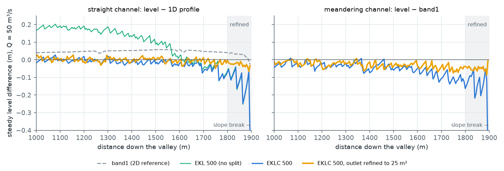

*Steady level at 50 m³/s on the channel centreline. Left: minus the 1D profile on the
straight channel. Right: minus band1 on the meander. The shaded band is the only area
refined in the yellow run. The curves stop at the break: below it, a flat cell level
compared with a steep surface at one point is a sampling artefact.*

| x (m) | 1D depth | band1 | EKLC 500 | EKLC 500, x > 1800 refined to 25 m² | EKL 500 |
|---|---|---|---|---|---|
| 1000–1650 | 2.26–2.06 | +0.04 to +0.06 | −0.02 to +0.02 | −0.01 to +0.02 | +0.00 to +0.19 |
| 1700 | 2.01 | +0.047 | −0.065 | +0.012 | −0.049 |
| 1800 | 1.86 | +0.041 | −0.070 | −0.002 | −0.063 |
| 1850 | 1.73 | +0.032 | −0.122 | −0.032 | −0.128 |
| 1875 | 1.63 | +0.020 | −0.188 | −0.040 | −0.193 |

*Straight channel: level minus the 1D profile (m).*

- **It isn't an unsteady effect.** EKLC 500 shows the same excess drawdown in steady
  flow: 7 cm low at 1800 and 19 cm low at 1875.
- **It isn't a general friction or momentum error.** Up to x = 1650, EKLC 500 is within
  2 cm of the 1D profile.
- **The source is the coarse cells at the control.** Refining only x > 1800 also fixes
  x = 1700–1800, upstream of the refined area. On the meander, the refinement turns a
  0.10–0.16 m deficit into 0.04–0.06 m, about the offset seen everywhere else. The
  coarse cells straddling the break pass too much water for their level near critical
  flow, and the low level carries upstream as backwater.
- **The 2D reference sits slightly high.** band1 is 4–6 cm above the 1D profile along
  the whole reach. That offset is part of what the flood comparison measured.
- **The conveyance split still matters.** EKL 500 is up to 0.19 m high upstream and has
  the same drawdown at the outlet.
- **EKLC 2000 is too coarse to judge here.** Its 65 m cells scatter by ±0.1–0.18 m
  against a 250 m drawdown, with no clear trend.

**Remedy:** refine the coarse mesh at hydraulic controls (slope breaks, weirs, steep
outlets), as is usual meshing practice. This works now. The alternative is a flux
treatment for near-critical edges, so that a cell straddling the break passes the right
discharge for its level. That would be new work in the edge-flux kernel.

## The reference bias (#509, fixed in #510)

Partway through, the subgrid runs seemed to drain the floodplain too fast. The cause was in
the references. ANUGA's central-upwind flux mixes the momentum *along* an edge between the
two cells at roughly the gravity-wave speed: the dissipation term is about ½√(gh)·Δ(vh).
In the exact Riemann problem that component only moves with the flow *across* the edge,
which is near zero along a channel bank. So the old flux dragged the fast channel water
against the slow bank water: resolved channels came out too rough, the flood wave slowed,
and too much water spilled onto the floodplain.

The switch replaces only the tangential momentum flux with the HLLC form, mass flux ×
the upwind cell's tangential velocity; mass and normal momentum are unchanged. On a
straight trapezoid the resolved channel carries this share of its true conveyance:

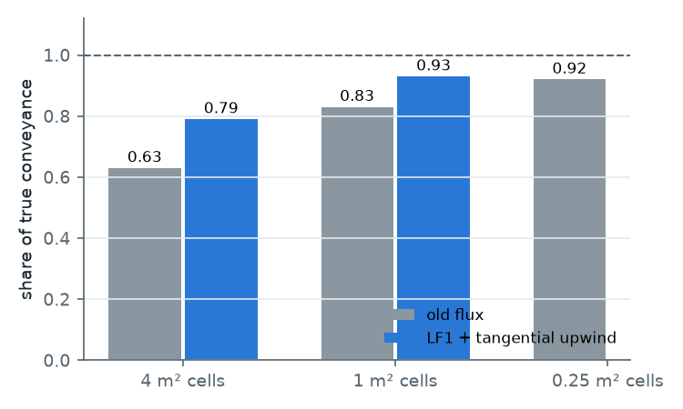

| cell size | old flux | LF1 + tangential upwind |
|---|---|---|
| 4 m² | 0.63 | 0.79 |
| 1 m² | 0.83 | 0.93 |
| 0.25 m² | 0.92 | — |

Breaklines and flow-aligned meshes don't fix it. Turn the switch on with
`domain.set_tangential_upwind()` after `set_low_froude`, or `set_low_froude(5)`; in the
bench, use `SUBGRID_LOW_FROUDE=5`. Even the corrected references are about 7% short of
true conveyance, so the Manning normal depth stays the cleanest steady check. A side fix
for breakline meshes ignoring the maximum triangle area is in PR #512 (issue #511).

## Next: better closures from the fine terrain

The tables answer two questions for each cell: how much water it holds at level η, and
how easily that water flows. Storage is exact. The flow part is a guess at how the
sub-triangles combine, and the flat-plain bench shows where the guess fails.

### Where the current closure falls short

`flat_plain.py` feeds 5 m³/s onto a 1500 × 150 m plain (n = 0.05) and tracks the wet
front. A fine 4 m² mesh is the reference; the subgrid runs use 1000 m² cells. Distance
(m) to which 90% of the water has spread after 2 h:

| ground | fine 4 m² | subgrid | + strips |
|---|---|---|---|
| flat | 830 | 840 | 840 |
| 0.15 m ridges, every 100 m | 720 | 860 | 830 |
| random relief, σ = 0.1 m | 710 | 830 | 710 |

- **The conveyance is an upper bound.** Kc adds the sub-triangles' conveyance as if they
  all flowed side by side. That is right for flow along a ridge and too fast across it.
- **The strips are a heuristic.** They cut the cell into strips across the flow and
  treat the strips as being in series (`--dir`, `add_directional`). On the random relief
  that matches the fine run. But a channel that enters a cell partway along leaves
  strips with only bank in them; those hit the floor and choke the channel. A private
  real-river check showed the same fault.
- **Storage is instant.** The tables assume the water in a cell is level, so ground
  behind a low sill fills as soon as the cell level reaches the sill, not over the time
  a flood takes to get through the gap.

### 1 · A conveyance tensor from a cell problem

Numerical homogenisation, as reservoir models turn fine-scale permeability into
grid-block tensors (Durlofsky 1991). For slow, friction-dominated flow in a cell,
Manning gives the local discharge per unit width:

$$\mathbf q = -k(\mathbf x)\,|\nabla\eta|^{-1/2}\,\nabla\eta,\qquad k = \frac{(\eta - z)_+^{5/3}}{n},\qquad \nabla\cdot\mathbf q = 0 \ \text{in } \Omega_c$$

Freeze the depth at the cell level and the slope magnitude at a reference value, so the
problem is linear. For each unit direction $\mathbf e_j$ solve for a correction $\phi_j$:

$$\nabla\cdot\big(k\,(\mathbf e_j + \nabla\phi_j)\big) = 0 \ \text{in } \Omega_c,\qquad \phi_j = 0 \ \text{on } \partial\Omega_c$$

$$K^*_{ij}(\bar\eta) = \frac{1}{|\Omega_c|}\int_{\Omega_c} k\,(\delta_{ij} + \partial_i\phi_j)\,dA,\qquad \langle\mathbf q\rangle = -|\mathbf G|^{-1/2}\,K^*\,\mathbf G$$

$K^*$ is symmetric, 3 numbers per level, and goes in the tables beside h(η) and Kc(η).
It lies between the series and parallel averages:

$$K_s = \Big(\tfrac1m\sum_j k_j^{-2}\Big)^{-1/2} \le \hat{\mathbf G}\cdot K^*\hat{\mathbf G} \le K_c = \tfrac1m\sum_j k_j$$

Today's Kc is the upper bound. On flat ground all three are equal.

- **Friction with a tensor.** $\mathbf S_f = |K^{*-1}\mathbf q|\,K^{*-1}\mathbf q$, source
  $= -g h\,\mathbf S_f$. With $K^* = K_c I$ this is today's friction. The exact form has
  a component across **q**, which needs a change to the friction kernel. Keeping only
  the part along **q** fits the scalar n_eff:
  $K_\theta^{-2} = |K^{*-1}\hat{\mathbf q}|\,(\hat{\mathbf q}\cdot K^{*-1}\hat{\mathbf q})$,
  $n_\text{eff} = h^{5/3}/K_\theta$.
- **Where to solve it.** On the DEM pixels in the cell, with a two-point flux and face
  conductance 2k_a k_b/(k_a + k_b). The 64 sub-triangles are too coarse to carry a 2 m
  channel through the cell.
- **Cost.** Cells × levels × 2 small sparse SPD solves: 10⁴ cells at 20 levels is
  4 × 10⁵ solves, minutes in parallel, once per mesh.
- **Boundary condition.** φ = 0 on the cell edge overstates connections; solving on the
  cell plus a ring of pixels and averaging over the cell only (oversampling) reduces it.
- **Nonlinearity.** Check the frozen-slope tensor against the nonlinear (p-Laplacian,
  p = 3/2) cell problem at two slopes.
- **Edge version.** The same solve on the union of two neighbouring cells, with η = 1
  and 0 on their outer boundaries, gives a transmissibility $T_{AB}(\bar\eta)$. In the
  friction-dominated limit the edge discharge should approach
  $T_{AB}\,\mathrm{sgn}(\eta_A-\eta_B)\,|\eta_A-\eta_B|^{1/2}$, and the subface weights
  could be scaled to meet it. A ridge on the edge shows up as a small $T_{AB}$ until
  the level clears it, which is the principled form of the connectivity rule.

### 2 · Two storage compartments per cell

Early filling is a matter of timing, which no table of level against volume can fix.
Give each cell a second store for ground behind a sill:

$$V = V_c(\eta_c) + V_p(\eta_p),\qquad \frac{dV_p}{dt} = Q_w$$

$$Q_w = C_w\,w_s\sqrt g\;\mathrm{sgn}(\eta_c-\eta_p)\,H^{3/2}\,\psi,\qquad H = \max(\eta_c,\eta_p) - z_s,\qquad \psi = \Big(1 - \big(\tfrac{H_d}{H}\big)^{3/2}\Big)^{0.385}$$

- The coarse scheme sees only the connected level η_c. The operator moves Q_w Δt
  between the stores, so mass stays exact. ψ is Villemonte's drowned-weir correction.
- The sill level z_s is the spill level from the minimax search; V_p comes from the
  sub-triangles behind the sill; w_s is the length of sill at z_s plus a few centimetres.
- The exchange is stiff when w_s is wide and V_p small: integrate it implicitly or limit
  it to the level difference.
- Close to dual integral porosity (Guinot, Sanders & Schubert 2017), applied to terrain.
- A first version is in `pond_storage.py` (`flat_plain.py --pond`). Not yet scored.

### 3 · A learned closure, last and as a correction

A learned antisymmetric correction to the edge flux that vanishes at rest, trained on
fine runs over synthetic terrain. Only once items 1 and 2 have run out of improvement.

### The reconstruction is effectively first order in subgrid cells (measured 2026-11-12)

The bench runs on this checkout's default, `DE0`: Euler in time, a limited P1
reconstruction in space (`beta_w = 0.5`, `beta_w_dry = 0`). In the steady straight-channel
run (EKLC 500, Q = 50 m³/s) the limited stage gradient the flux kernel reads is close
to zero in the channel cells:

| reach (m) | channel cells | limited dη/dx | unlimited dη/dx | ratio |
|---|---|---|---|---|
| 1600–1800 | 17 | −0.00004 | −0.0028 | 0.01 |
| 1800–1900 | 8 | −0.0005 | −0.0090 | 0.06 |
| 1900–1980 | 7 | 0 | −0.021 | 0 |

The unlimited gradient is the plane through the three neighbour centroids. The cause is
the wet/dry factor in the edge extrapolation: it scales beta from `beta_w_dry` to
`beta_w` as the smaller of hmin/hc and hc/hmax over the cell and its neighbours goes
from 0.1 to 0.3 (`ANUGA_HFACTOR_B`, `ANUGA_HFACTOR_A`). It reads the *mean* depths. A
channel cell next to a bank cell has a depth ratio near 0.1 although both share one
level: the median over the wet cells at x = 1000–1900 is 0.12, and every cell below
0.1 (33 of 89) has a zero gradient.

So the subgrid scheme is P0 in the level almost everywhere, and the level-surface
pieces (η(h), the bed source on the centroid level, one stage per edge side, one
friction slope per cell) are consistent with what the reconstruction delivers.
`DE_ader2` (beta 1.0, half-step predictor) zeroes the same cells, and its level is within
4–6 mm of DE0 at x = 1550–1850.

### A P1 level from connected neighbours: tried, parked (2026-11-12)

`Subgrid_storage_operator.enable_p1_level()` (`SUBGRID_P1=1`, off by default) rebuilds
the edge levels after each extrapolation. A neighbour counts if both cells are wet and
the lower of the two levels is more than 2 cm above the lowest subface bed of the shared
edge. The gradient is a least-squares fit over those neighbours, limited as ANUGA does.
Edge mean depth and momentum are set to the cell's own (P1 level, P0 discharge).

Same steady run; slope is the share of the unlimited slope recovered, level is against
the DE0 baseline:

| run | slope 1600–1800 | slope 1800–1900 | level, x = 1050–1700 | level, x = 1800–1850 |
|---|---|---|---|---|
| DE0 baseline | 0.01 | 0.06 | 0 | 0 |
| DE0 + P1, beta 0.5 | 0.54 | 0.40 | −2 to −3 cm | −0.3 cm |
| DE0 + P1, beta 1.0 | 0.72 | 0.55 | −2 to −3 cm | +1.4 cm |
| DE_ader2 + P1, beta 1.0 | 0.68 | 0.55 | −7 to −8 cm | −2.8 cm |

- It works mechanically: 95% of the wet cells get a gradient, the runs are stable and
  the step count is unchanged.
- **It does not fix the outlet reach.** The baseline is 7–12 cm low against the 1D
  profile at x = 1800–1850 and the P1 level moves that by at most 1.4 cm. The flat level
  in the control cells is not the cause.
- **It biases the uniform reach low**, where the baseline was within 2 cm of the 1D
  profile. Causes not verified. Suspects: the kernel scales each subface velocity by
  its depth at the edge level, so a tilted level changes the edge discharge although the
  cell's discharge is constant; and for the extra 5 cm on DE_ader2, the predictor's
  gravity term, which uses the mean depth times the level slope.
- Parked. Reproduce with `grad_probe.py` (see its docstring).

### Plan

1. Build the cell-problem tensor in `subgrid_tables.py` and test it on the flat-plain
   bench. Add a meandering-channel plain, the case that broke the strips.
2. Compare the full tensor friction with the along-flow version, and check the slope
   dependence with the nonlinear cell problem.
3. If it holds up, re-run the private real-river case against its fine reference.
4. Then the two-compartment storage, aimed at the floodplain onset.

## Where the code is

### In ANUGA (`anuga/shallow_water`), committed in 18c1c851

All of this is inactive unless the subgrid attributes below are set on the domain, so
default runs are unchanged. The full suite passes: 4062 passed, 6 skipped, with MPI.

| Piece | Where | What it does |
|---|---|---|
| `core_compute_fluxes_subgrid` | `gpu/core_kernels.c` (CPU-only build branch) | splits each edge into `nsub` subfaces with their own bed; sums the central flux and hydrostatic pressure over the subfaces; replaces the flux + gravity terms, like the central kernel |
| conveyance split | inside the same kernel | with `subgrid_edge_invn` and `subgrid_cell_neff`, the subface velocity is u·n_eff/n_j·(h_j/h_edge)^(2/3); a uniform cell gives weight 1 exactly, and boundary sides mirror the interior weights |
| `core_subgrid_drain_limit` | `gpu/core_kernels.c` | draining-time limiter: scales a cell's outgoing fluxes so it can't go below dry within the step; uses per-slot fluxes the kernel records |
| Cython wrappers | `sw_domain_openmp_ext.pyx`: `compute_fluxes_ext_subgrid`, `subgrid_drain_limit` | shape checks, pass-through |
| Domain hooks | `shallow_water_domain.py`: `compute_fluxes`, `update_conserved_quantities` | switch to the subgrid kernel when `domain.subgrid_edge_z` is set (mode 1 only, otherwise `NotImplementedError`); apply the limiter when `domain.subgrid_drain_limiter` is set |

The domain attributes are set by the bench operator:
- `subgrid_edge_z`: (3n, nsub) subface beds;
- `subgrid_edge_invn`: (3n, nsub) 1/n per subface;
- `subgrid_cell_neff`: (n,) effective Manning, refreshed in place every step;
- `subgrid_drain_limiter`: bool.

### In the bench (`subgrid_bench/`), committed in 9feda8ac

All synthetic. Run outputs (`results/`, `*.npz`, logs, plots) stay local through
`subgrid_bench/.gitignore`.

| File | Role |
|---|---|
| `terrain.py` | analytic valley: 2000 × 500 m, slope 1:1000, a meandering trapezoidal channel (10 m base, 2 m deep, 1:2 banks), a floodplain with hollows, and an outlet control at x = 1900. `SUBGRID_AMPLITUDE=0` straightens the channel |
| `subgrid_tables.py` | the method: `SubgridTables` (sorted sub-triangle beds, h(η), η(h), f(η), Kc(η)), `edge_subface_beds` (subface beds and 1/n), and `Subgrid_storage_operator` (the per-step update). Experimental, off by default: hollow sills (`SUBGRID_HOLLOWS=1`), the connectivity rule (`connectivity=True`), direction-dependent strips (`directional=True`), and series or geometric conveyance averaging (`SUBGRID_KMEAN`) |
| `run_phase0.py` | hydrograph runs (5 → 60 → 5 m³/s, 5.5 h) for every variant; `--gpu`, `--diag`; environment switches `SUBGRID_TAG` and `SUBGRID_LOW_FROUDE` |
| `evaluate_phase0.py` | scores the runs against a reference: flood-extent CSI, peak Q and its timing, arrival time, peak stage |
| `report_figures.py` | the figures in this report, from the `results/*_diag*.npz` files |
| `test_phase1.py`, `test_phase2.py` | lake at rest with partly wet cells, mass conservation, dam breaks (run as scripts; all pass) |
| `static_storage.py`, `static_conveyance.py`, `static_edges.py` | static checks of storage, conveyance and edge area/conveyance against the DTM |
| `steady.py`, `trap_conv.py` | steady runs against Manning normal depth; the straight-trapezoid check that found the reference bias |
| `steady_outlet.py`, `gvf_1d.py`, `compare_outlet.py` | the outlet-reach study: steady runs at a fixed Q (with `SUBGRID_OUTLET_AREA` refining x > `SUBGRID_OUTLET_X`), the 1D standard-step profile, and the comparison and figure |
| `outlet_eq.py` | flood runs against the reference's volume-equivalent level in each coarse cell |
| `flat_plain.py`, `flat_summary.py`, `flat_profile.py` | the flat-plain front-speed bench (flat, ridged, rough ground; `--conn`, `--dir`, `--pond`, `--no-conv`) and its summaries |
| `pond_storage.py` | two-compartment storage: `PondStore` and `Pond_exchange_operator` (weir exchange between the connected store and ponds behind sills) |
| `grad_probe.py` | limited against unlimited stage gradient near the slope break, for DE0, `PROBE_ALG=DE_ader2` and the `SUBGRID_P1=1` level |
| `launch_*.sh` | the tmux batch scripts used for each round of runs |

## Known issues and open items

1. **Outlet reach:** explained (see *The outlet reach*). The coarse cells at the
   critical control draw the level down by up to 0.19 m. Refining them to 25 m² fixes
   it. A flux treatment for near-critical edges is optional future work.
2. **Unsteady differences:** on the rising limb the level at Q = 20 is 1.28 against
   1.46 m on the 500 mesh, partly a loop-rating effect. On the falling limb the near
   floodplain holds 0.1 against 0.7 thousand m³ at 4.5 h.
3. **Cap CFL:** 0.5 for the C variants costs about 1.5× the steps of 0.75. A wet-fraction
   cap also works but is slower.
4. **Prototype limits:**
   - Kc is evaluated directly, O(m) per cell per step, not tabulated.
   - The operator runs in Python.
   - Mode 1 only.
   - The edge-flux kernel is per cell, so each edge is computed twice.
5. **Not yet done (Phase 3):**
   - a `DE_subgrid` flow algorithm in place of the operator;
   - mode 2 / GPU kernels;
   - an audit of anything that converts between depth and volume (inlets, rain,
     culverts, set-stage, `get_water_volume`);
   - parallel partitioning of the tables;
   - SWW output with downscaled depth;
   - a DEM-based builder.
6. **Private real-world check:** the Serna case (#453) was re-scored on 2026-11-09.
   Its data and results stay outside the repo.

## How to run

```bash
conda activate anuga_subgrid_env_3.14      # CPU build, has mpi4py
cd subgrid_bench
OMP_NUM_THREADS=8 python run_phase0.py coarse2000_sub8EKLC --diag
SUBGRID_LOW_FROUDE=5 SUBGRID_TAG=_tu OMP_NUM_THREADS=8 python run_phase0.py coarse500_sub8EKLC --diag
python evaluate_phase0.py band025TU        # score everything in results/ against a reference
python report_figures.py                   # redraw claude/figures/subgrid/*.png
PYTHONPATH=$PWD python test_phase2.py      # tests run as scripts
python trap_conv.py 1 LF=5                 # straight trapezoid check
bash launch_outlet.sh                      # outlet study: steady Q = 50 runs (about 3 h)
SUBGRID_AMPLITUDE=0 python gvf_1d.py 50    # 1D profile for the straight channel
python compare_outlet.py --fig ../claude/figures/subgrid   # tables and outlet.png
```

`report_figures.py` needs the `--diag` results of band025 (TU), band1 (old flux and
LF4), coarse500_sub8EKL, coarse500/2000_sub8EKLC and coarse500_centroid.

For GPU reference runs, use `anuga_subgrid_gpu_env_3.14`. That build doesn't track
header changes: after editing a header, touch the `.c`/`.pyx` files that include it
and run `ninja` in `build-gpu` with nvc on PATH.

## Commits on develop_subgrid

| commit | content |
|---|---|
| 30073834 | handoff notes |
| 18c1c851 | subgrid edge flux kernel, draining-time limiter, conveyance split |
| 9feda8ac | bench code tracked (outputs ignored) |
| 131d7fb5 | merge develop: tangential upwind flux (#510), breakline area limit (#512) |
| b9f22192 | bench uses `set_low_froude` for the switch |
| b52906f0 | status report; bench runs with the switch on |
| d9d8bbe3 | status rescored against band025TU |
| f096cbc9 | status report with figures; `--diag` channel split fixed |
| b9b3c0a3 | outlet-reach study |
| d8499d6a | flat-plain bench; experimental closures (hollows, connectivity, strips, two-compartment storage); closures plan |
| 121a38f0 | limited stage gradient measured: near zero in subgrid cells |
| (this commit) | P1 level from connected neighbours (off by default), a negative result; `grad_probe.py`; `SUBGRID_ALG` switch |

The branch is pushed to `origin` (the stoiver fork).
